# S3Wear Community

<p align="center">
  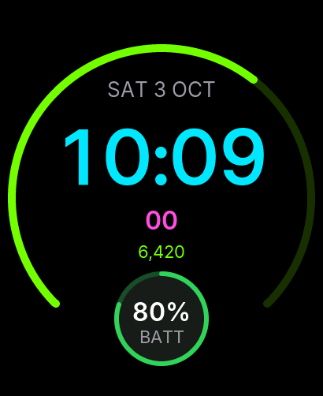
  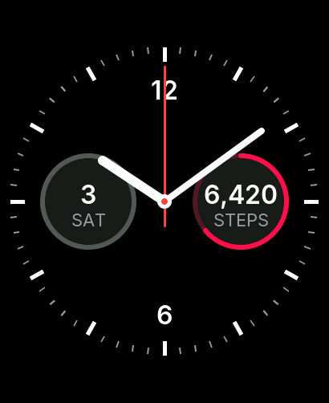
  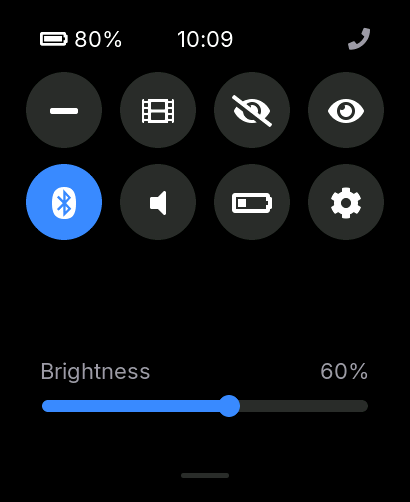
  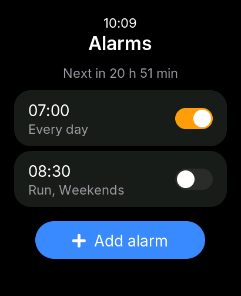
</p>
<p align="center"><a href="#community-screenshots">More screenshots</a> · <a href="https://s3wear.fiqraat.com/install/">Install from your browser</a></p>

Open-source smartwatch OS for the **Waveshare ESP32-S3-Touch-AMOLED-2.06**. A complete standalone watch: watch faces with always-on display, raise to wake, alarms that wake the watch from deep sleep, timers, stopwatch, world clock, do-not-disturb / sleep / theater modes, battery management and an on-watch Settings app. Every screen also runs in a desktop simulator.

Status: Phases 0–3 (M1 "It's a watch").

**Website, installer and Pro free trial: [s3wear.fiqraat.com](https://s3wear.fiqraat.com)**

This is the **Community edition**: free, open source, and a complete standalone watch. It is published from a private source repository, one commit per release (see [CONTRIBUTING.md](CONTRIBUTING.md)). The paid **S3Wear Pro** edition adds the phone link, the Android companion app, installable apps and games with an app store, and over-the-air updates. The Community edition has no installable apps or games.

[](https://s3wear.fiqraat.com/install/) [](https://s3wear.fiqraat.com/pro/)

## Install without building

No command-line tools needed. Plug the watch in with USB-C and install from Chrome or Edge at **[s3wear.fiqraat.com/install](https://s3wear.fiqraat.com/install/)**, or from the Android app. Pick **Community** (free, installs at once) or **Pro** (free trial). Building from this repository is covered under [Build](#build).

## What the Community edition has
- Watch faces (native and declarative `face.json`) with always-on display and raise to wake.
- Quick settings, tiles, launcher, alarms, timer, stopwatch, world clock.
- Do-not-disturb, sleep and theater modes, battery and charging screens, on-watch Settings, system sounds.
- USB mass storage for side-loading faces.

## Community vs Pro

Both editions run the same watch OS on the same board. Pro is the same firmware with a licence that unlocks the features below. Full table: [s3wear.fiqraat.com/pro](https://s3wear.fiqraat.com/pro/).

| Feature | Community (this repo) | Pro |
|---|:---:|:---:|
| Watch faces (native and `face.json`), face picker | ✅ | ✅ |
| Always-on display, raise to wake | ✅ | ✅ |
| Quick settings, launcher, tiles | ✅ | ✅ |
| Alarms, timer, stopwatch, world clock | ✅ | ✅ |
| Do-not-disturb, sleep and theater modes, battery screens, Settings | ✅ | ✅ |
| Step count | ✅ | ✅ |
| USB mass storage (side-load faces) | ✅ | ✅ |
| Source code | Apache-2.0, public | Proprietary |
| Android companion app | – | ✅ |
| Phone notifications and replies | – | ✅ |
| Health and workouts, Health Connect | – | ✅ |
| Calls and media control | – | ✅ |
| Weather and calendar | – | ✅ |
| Find phone, voice memos | – | ✅ |
| Home Assistant | – | ✅ |
| Installable apps and games, app and game store | – | ✅ |
| Retro handheld player for your own game files | – | ✅ |
| Wi-Fi, flashlight, QR wallet | – | ✅ |
| Signed over-the-air updates | – | ✅ |
| Support | GitHub issues, best effort | Email |

A watch without a Pro licence always runs as Community. Nothing is deleted when a trial ends.

## Try Pro free

1. Open the [installer](https://s3wear.fiqraat.com/install/) and choose **Pro, free trial**.
2. Pair the watch with the S3Wear app over Bluetooth. Pairing starts a **14-day trial** (one per watch).
3. Keep it for good with a one-time purchase in the Android app (no subscription; the price is shown in the app before you buy). Or do nothing: the watch keeps working as Community.

## Pro highlights

Screenshots from the watch firmware's own test suite.

| | | | |
|---|---|---|---|
|  |  |  |  |
| Apps from the store | Asks before it installs | 2048 | Breakout |

- **App and game store**: browse in the Android app and install in a tap. Every app asks before it gets any permission.
- **Notifications**: read and reply from your wrist.
- **Retro handheld player**: bring your own game files.
- **Over-the-air updates** and the full phone link.

**[Start the free trial →](https://s3wear.fiqraat.com/pro/)**

## Community screenshots

From the SDL2 simulator at the panel's native 410×502, Community build. These are the UI snapshot test goldens in [firmware/test/ui_snapshots/community/](firmware/test/ui_snapshots/community/).

| | | | |
|---|---|---|---|
| 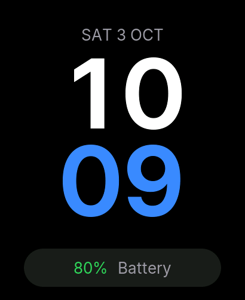 |  | 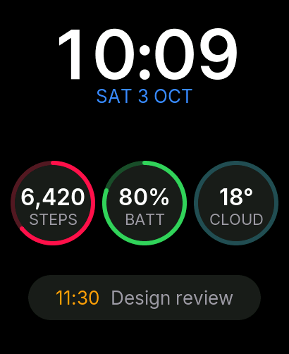 |  |
| 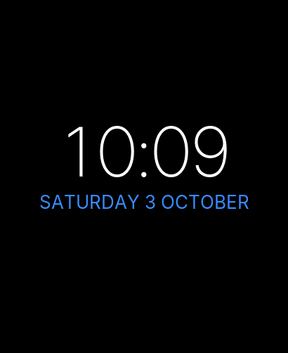 | 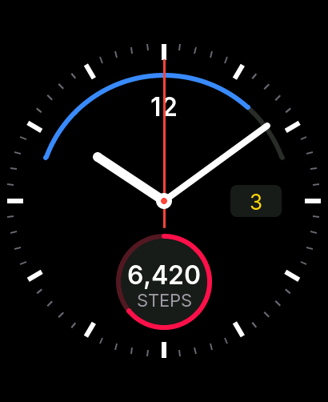 | 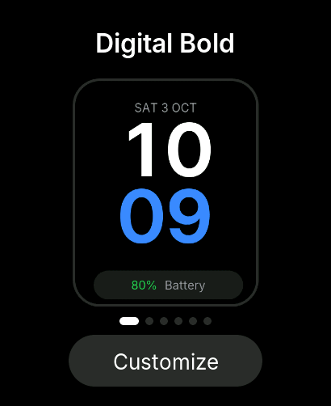 |  |
| 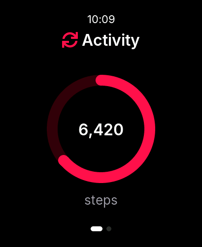 | 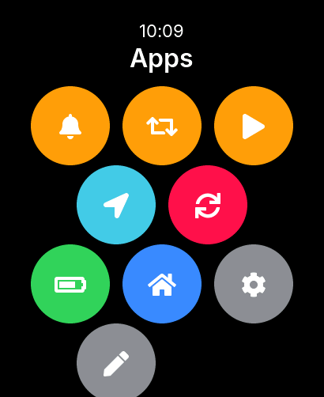 | 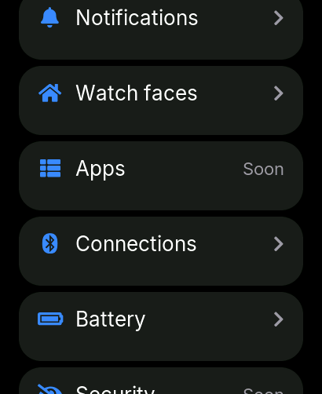 | 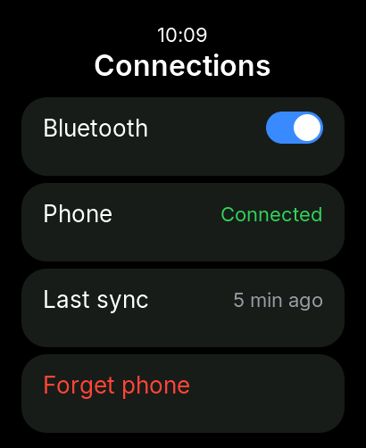 |
|  | 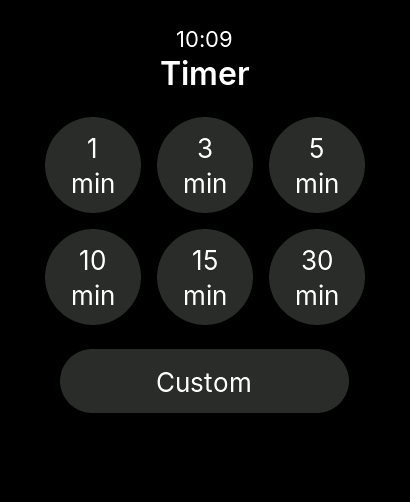 | 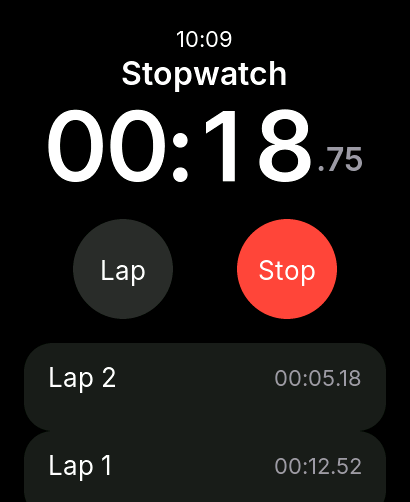 | 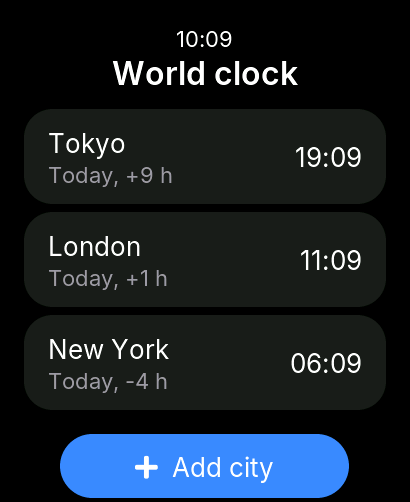 |
| 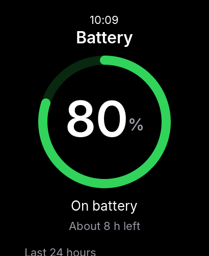 | 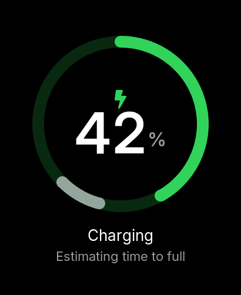 |  |  |

## Build

```bash
# Firmware (ESP-IDF v5.5.x exported)
cd firmware && idf.py set-target esp32s3 && idf.py build
idf.py -p /dev/cu.usbmodem* flash monitor

# Simulator (SDL2) and its snapshot tests
cmake -S firmware/simulator -B build/sim && cmake --build build/sim
./build/sim/s3w_sim
ctest --test-dir build/sim

# Host unit tests
cmake -S firmware/host_test -B build/host_test && cmake --build build/host_test && ctest --test-dir build/host_test
```

CI builds the firmware and runs the host and snapshot tests on every push ([.github/workflows/ci.yml](.github/workflows/ci.yml)).

## Documentation

| Document | Purpose |
|---|---|
| [docs/01-hardware.md](docs/01-hardware.md) | Hardware inventory, pin map, I2C map, gotchas |
| [docs/bringup-phase1.md](docs/bringup-phase1.md) | Board bring-up checks |
| [docs/vendor/README.md](docs/vendor/README.md) | Vendor references and values taken from them |
| [protocol/](protocol/) | `.proto` sources and golden test vectors |

## Repository layout

| Path | Contents |
|---|---|
| [firmware/](firmware/) | ESP-IDF project: `main/`, `components/`, `simulator/` (SDL2), `test/` (UI scenarios and goldens), `host_test/` (GoogleTest) |
| [protocol/](protocol/) | Watch ↔ phone protocol sources |
| [tools/](tools/) | Font generator |

Some Pro-only components appear as empty stubs under `firmware/components/` so the build files stay identical in both editions.

## Licence

Code: [Apache-2.0](LICENSE). Docs: [CC-BY-4.0](LICENSE-DOCS). Contributions need the [CLA](CLA.md). Not affiliated with Waveshare.
